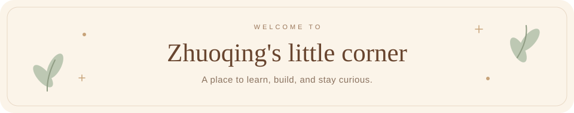

  

  
  &nbsp;
  

  
   
  Meet Lili, my little coding companion. Little monkey, busy coding.

  

### A little about me

Hi, I'm **Zhuoqing Zhong**, a master's student in **Electrical and Computer Engineering at Carnegie Mellon University**. Previously, I earned my B.Sc. in Computer Science from **Kean University**.

I'm interested in multimodal learning and reliable language models. My research experience includes language model interpretability, rejection behavior, and cognitive screening.

### On my desk

| Learning to see & understand | Learning to act & be reliable |
| :--- | :--- |
| Multimodal large language models · Computer vision | Reinforcement learning · Reliable language models |

I'm also curious about **world models** and **language model agents**.

### From my research notebook

- **[Position: Multimodal LLMs Should Learn from Children](https://openaccess.thecvf.com/content/CVPR2026W/CV4CHL/html/Shen_Position_Multimodal_LLMs_Should_Learn_from_Children_CVPRW_2026_paper.html)** 
  Learning from the way children form tasks, infer supervision, and keep growing. · *CVPR Workshops, 2026*
- **[Improving Negative Rejection Ability in Language Models](https://doi.org/10.1007/s44443-025-00334-6)** 
  A review of fine-tuning, RAG, and RAFT for more reliable language models. · *JKSUCIS, 2026*

  <a href="https://zhuoqinz.github.io/#publications">More publications ↗</a>
  &nbsp; · &nbsp;
  <a href="https://zhuoqinz.github.io/files/Zhuoqing_Zhong_CV.pdf">Curriculum vitae ↗</a>

  

  <b>Have a research idea? Let's talk.</b> 
  I'm looking for research collaborations and mentorship as I work toward a Ph.D.  
  <a href="mailto:zhuoqinz@andrew.cmu.edu">zhuoqinz@andrew.cmu.edu</a>
  &nbsp; · &nbsp;
  <a href="https://www.linkedin.com/in/zhuoqing-zhong-909679406">LinkedIn</a>

  

